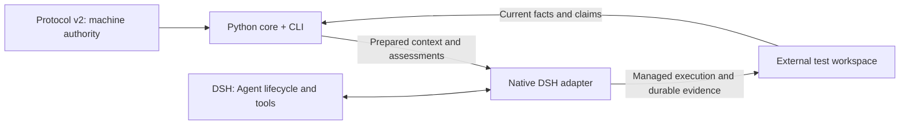

# BUGate v2

English | [简体中文](README.zh-CN.md)

BUGate defines the quality requirements for a finite acceptance task and evaluates
whether recorded facts support its claims. It connects the user's goals to
business requirements, observable Oracles, required cases and actual execution
evidence, so an Agent can explain **what was covered, what happened and what can
be concluded**.

**DeepSeek Harness (DSH) is the only product host.** BUGate supplies a host-neutral
Python core, a versioned protocol and a unified CLI. Its native DSH plugin uses
those evaluations to constrain managed execution and completion. DSH owns the
Agent loop, tools, scheduling, session lifecycle and bounded rework.

## Acceptance follows the user's goal

The default is the smallest sufficient evidence closure for the agreed goals.
This keeps breadth finite while requiring sufficient depth: if a goal includes a
persisted business result, a successful API response alone does not prove it.
Permission, boundary, failure or multiple-flow behavior is required when the
user's goal or adopted requirements include it. No generic risk matrix adds
these categories to every task.

- **Profile** declares domain evidence sources and fixes the requirement/risk
  coverage denominators for the task.
- **ScopeRequest** records an actual user choice. **ScopeContract** binds finite
  goals, objects/environments, flows and necessary branches, Oracles, scenario
  necessity, exclusions, auxiliary bounds and completion conditions to a version
  and digest. User choice does not replace domain evidence.
- The existing **case inventory** is the executable plan. Required cases trace
  to the current scope, requirements, Oracles and expected evidence. Source-backed
  semantic review judges necessity; populated fields alone do not.
- **Suggestions** retain out-of-scope ideas without executable plans, required
  coverage or completion blockers. Reads, data preparation, evidence inspection,
  cleanup and failure-linked bounded diagnosis remain auxiliary activities.

To expand testing, state the additional goal or required behavior explicitly.
Authorized branch/Oracle changes within the locked Profile denominator create a
new scope revision. A denominator change requires a new Profile version and a
new task. Previous facts and failures remain; old assessments cannot authorize
changed inputs. This version conservatively requires fresh execution after scope
changes rather than selectively reusing old evidence.

See [scope behavior and examples](docs/ACCEPTANCE_SCOPE.md), including explicit
permission requirements, failed acceptance and nonblocking suggestions. These
examples do not define a default SUT test matrix.

## Evidence and conclusions stay separate

An Oracle states the observable business result that would demonstrate a
requirement. Structural validation, semantic review and observed execution are
separate assessment dimensions. Model-reported pass flags, content hashes and
command success do not establish that business result.

| Observed state | Supported conclusion |
|---|---|
| Required execution and evidence are complete; Oracles hold | Execution complete; the covered requirements are verified. |
| Required execution and evidence are complete; a real Oracle fails | Execution complete; functional acceptance failed. Preserve the failure. |
| Required execution or evidence is missing, skipped or unobserved | Execution/evidence closure is incomplete; verification is not established. |
| Out-of-scope suggestions remain | The in-scope conclusion is unchanged; suggestions remain separate. |

`execution_complete` and `requirement_verified` are independently evaluated claims.
Verifying one named requirement does not mark other required work complete.
Reports identify actual coverage, functional results, execution blockers and
suggestions, and state: **“This conclusion covers only the agreed scope.”**

## Architecture and authority



| Location | Responsibility |
|---|---|
| [`protocol/v2/`](protocol/v2/) | The sole machine specification: Schemas, MethodSpec, quality rules and reason codes. |
| [`src/bugate/`](src/bugate/) | Host-neutral validation, snapshots, evidence and claim assessment; one JSON CLI. |
| [`adapters/deepseek-harness/`](adapters/deepseek-harness/) | Native tools, execution admission, context/lifecycle integration and actual DSH acceptance tests. |
| [`views/skills/bugate/`](views/skills/bugate/) | Small entry projection; the build appends canonical MethodSpec resources and seals their digest. |
| [`packaging/`](packaging/) | Explicit resource inventory, standalone wheel/native bundle and owned installation lifecycle. |
| [`docs/qa-methodology/`](docs/qa-methodology/) | Explanations of the protocol and workflow. |

`PreparedProtocolContext` carries the exact current binding and actionable gaps.
Resumed sessions, children and independent presets prepare their own binding.
The adapter awaits preparation and durable evidence publication at supported DSH
seams; synchronous context/guard callbacks consume completed state. Execution
uses configured filesystem/subprocess providers and declared case/activity
identities. These checks govern observable managed operations; they do not infer
every business meaning from arbitrary shell text or override host permissions.

## Install and start a task

Installation is pinned to
[`dsh-v2.1.0-dev.1`](https://github.com/ZhangLiangchen/BUGate/releases/tag/dsh-v2.1.0-dev.1):
Python `bugate-core 2.1.0a1`, native package `2.1.0-dev.1` and exact Protocol
`2.1.0-dev.1`. Follow the [one-step installation Prompt](INSTALL_DSH_PROMPT.md)
or the [installation and recovery guide](docs/DEEPSEEK_HARNESS.md). Use the bundle,
installer and checksum files from the same build, and choose an explicit external
test project, DSH profile and bootstrap environment. Runtime installation does
not need the BUGate source checkout.

The adapter targets DSH `0.2.2-alpha.2` and Node `24.9.0+`. The Python core requires
Python `3.11+`; bundled dependency wheels must match the Python/platform ABI
recorded in `python/inventory.json`. See the
[release notes](docs/releases/DSH_2_1_0_DEV_1.md) for the packaged platform and
verification results. Windows is unsupported. Python dependencies install
offline; DSH peer dependency resolution may require registry access.

After installation, author a source-backed Profile using the
[Profile Schema](protocol/v2/schemas/profile.schema.json) and initialize a task:

```sh
BUGATE=/absolute/path/bugate-bootstrap/bin/bugate
"$BUGATE" init --project /absolute/path/test-repo --task TASK-1 \
  --sut-profile /absolute/path/profile.json --json
"$BUGATE" protocol prepare \
  --task /absolute/path/test-repo/test-task/TASK-1 --json
```

Select that task in the DSH integration and state its finite acceptance goal.
DSH captures eligible user requests; the Agent records the scope and source-backed
design through native tools, runs configured tests, then assesses the appropriate
claims. [The workflow](docs/qa-methodology/SOP.md) and
[DSH usage guide](docs/DEEPSEEK_HARNESS.md) explain scope recording, task selection,
command configuration, inspection, revision and recovery.

The CLI emits one versioned `CommandResult` JSON envelope. A completed invocation
can report gaps or a failing test; inspect the command result and claim verdict.
This is a breaking v2 prerelease. Old task formats and retired host integrations
have no automatic conversion or fallback runtime.

## Develop and verify

Start with [AGENTS](AGENTS.md), [METHOD](docs/qa-methodology/METHOD.md),
[SOP](docs/qa-methodology/SOP.md) and the
[protocol guide](docs/qa-methodology/BUGATE_2_0_PROTOCOL_GUIDE.md).
[CONTRIBUTING](CONTRIBUTING.md) contains local setup, core regression, adapter
build, package boundary and real-runtime commands. Repository tests create neutral
temporary fixtures; real SUT sources, environments, secrets and task evidence stay
in external test workspaces.

The [scope-governance delivery record](docs/reports/scope-convergence/DELIVERY.md)
traces the implementation's formal requirements to actual core, DSH and installation
evidence at its recorded snapshots. Release packaging may have different resource
bytes; the [release notes](docs/releases/DSH_2_1_0_DEV_1.md) identify the exact
release artifacts and their verification instead of inheriting an older package's
result.

Recorded integration verification uses deterministic model fixtures driving the
real DSH runtime, including an installed-package run with source-checkout reads
denied. **Live-model validation was not run.** These observations do not establish
improved model quality or productivity. Local evidence hashes also do not
authenticate against an actor controlling the same filesystem.

| Read next | Purpose |
|---|---|
| [Capabilities](CAPABILITIES.md) | Supported behavior and product boundaries. |
| [Scope guide](docs/ACCEPTANCE_SCOPE.md) | Minimal sufficient evidence, scope changes and result examples. |
| [DSH guide](docs/DEEPSEEK_HARNESS.md) | Installation, tools, execution configuration and recovery. |
| [Protocol](protocol/v2/README.md) | Canonical entities and machine contracts. |
| [Architecture decisions](docs/reports/scope-convergence/ARCHITECTURE.md) | Scope design and engineering tradeoffs. |
| [Acceptance matrix](docs/reports/scope-convergence/ACCEPTANCE_MATRIX.md) | Requirement sources, Oracles and executed evidence. |

[MIT license](LICENSE).
