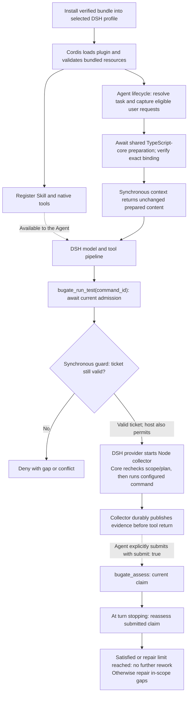
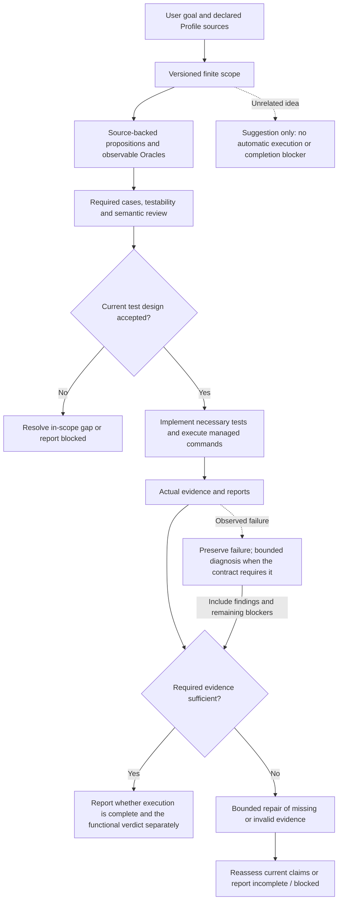

# BUGate v2

English | [简体中文](README.zh-CN.md)

BUGate defines the quality requirements for a finite acceptance task and evaluates
whether recorded facts support its claims. It connects the user's goals to
business requirements, observable Oracles, required cases and actual execution
evidence, so an Agent can explain **what was covered, what happened and what can
be concluded**.

**DeepSeek Harness (DSH) is the only product host.** This TypeScript branch supplies a host-neutral
TypeScript core, a versioned protocol and a unified Node CLI. Its native DSH plugin uses
those evaluations to constrain managed execution and completion. DSH owns the
Agent loop, tools, scheduling, session lifecycle and bounded rework.

**Implementation:** `2.2.0-dev.1` TypeScript core/toolchain and official DSH Agent
Team review are in progress under the 2026-10-30 request. Final cutover depends
on exact-package runtime and independent-install evidence. Historical Python
releases remain unchanged. See the [TypeScript/Cordis plan](docs/plans/TYPESCRIPT_CORDIS.md).

**Development tracks (2026-10-30):** the improved Python edition and full TypeScript
edition develop on separate branches/worktrees. The first field trial will use
the improved Python edition after its own runtime and installation acceptance;
TS development continues independently and does not automatically replace that
installation. See [branch boundaries and Python field trial](docs/plans/PYTHON_FIELD_TRIAL.md).
This checkout's implementation and installation instructions describe the TS track,
not a delivered Python improvement or a completed field trial.

## Acceptance follows the user's goal

The default is the smallest sufficient evidence closure for the agreed goals.
This keeps breadth finite while requiring sufficient depth: if a goal includes a
persisted business result, a successful API response alone does not prove it.
Permission, boundary, failure or multiple-flow behavior is required when the
user's goal or adopted requirements include it. No generic risk matrix adds
these categories to every task.

- **Profile** declares domain evidence sources and fixes the requirement/risk
  coverage denominators for the task.
- **ScopeRequest** records an actual user choice. **ScopeContract** binds finite
  goals, objects/environments, flows and necessary branches, Oracles, scenario
  necessity, exclusions, auxiliary bounds and completion conditions to a version
  and digest. User choice does not replace domain evidence.
- The existing **case inventory** is the executable plan. Required cases trace
  to the current scope, requirements, Oracles and expected evidence. Source-backed
  semantic review judges necessity; populated fields alone do not.
- **Suggestions** retain out-of-scope ideas without executable plans, required
  coverage or completion blockers. Reads, data preparation, evidence inspection,
  cleanup and failure-linked bounded diagnosis remain auxiliary activities.

To expand testing, state the additional goal or required behavior explicitly.
Authorized branch/Oracle changes within the locked Profile denominator create a
new scope revision. A denominator change requires a new Profile version and a
new task. Previous facts and failures remain; old assessments cannot authorize
changed inputs. This version conservatively requires fresh execution after scope
changes rather than selectively reusing old evidence.

See [scope behavior and examples](docs/ACCEPTANCE_SCOPE.md), including explicit
permission requirements, failed acceptance and nonblocking suggestions. These
examples do not define a default SUT test matrix.

## Evidence and conclusions stay separate

An Oracle states the observable business result that would demonstrate a
requirement. Structural validation, semantic review and observed execution are
separate assessment dimensions. Model-reported pass flags, content hashes and
command success do not establish that business result.

| Observed state | Supported conclusion |
|---|---|
| Required execution and evidence are complete; Oracles hold | Execution complete; the covered requirements are verified. |
| Required execution and evidence are complete; a real Oracle fails | Execution complete; functional acceptance failed. Preserve the failure. |
| Required execution or evidence is missing, skipped or unobserved | Execution/evidence closure is incomplete; verification is not established. |
| Out-of-scope suggestions remain | The in-scope conclusion is unchanged; suggestions remain separate. |

`execution_complete` and `requirement_verified` are independently evaluated claims.
Verifying one named requirement does not mark other required work complete.
Reports identify actual coverage, functional results, execution blockers and
suggestions, and state: **“This conclusion covers only the agreed scope.”**

## Architecture and authority

### How the plugin takes effect in DSH

Install into the profile that DSH actually starts, initialize a task with its
Profile, and select it through `taskPath` when discovery is ambiguous. Installation
and doctor establish configuration/integrity; an actual Agent session establishes
runtime hydration. Without a bound task this path does not activate; the plugin
does not initialize one automatically. The following path describes
`mode: managed` (the default).
`advisory` omits managed write admission, while assessment semantics and the
scope checks inside `bugate_run_test` still apply.



The Skill is registered at plugin load, not rebuilt after every preparation or
necessarily invoked by the model every turn. Awaited lifecycle refresh supplies
`PreparedProtocolContext`; synchronous context and guard callbacks only consume
completed state. A model-admission check rejects context invalidated in a race.
Each resumed/child session prepares its own binding rather than inheriting a
parent's local guard.

Managed test/activity calls accept a host-configured `command_id`, not arbitrary
model argv. The core rechecks scope/plan applicability and preserves real outputs
before returning. Known managed write tools have admission controls. For a bound
task, managed admission rejects native `bash` calls rather than inferring their
business meaning; use configured commands for execution.
Other tools remain subject to host policy. Filesystem/subprocess providers define
the execution world; opaque targets are not local paths.

Automatic completion checking applies after `bugate_assess` with `submit: true`.
Without submission, this completion-rework path does not start and DSH may stop
normally. At turn stopping the plugin reassesses a submitted claim; repair is
bounded by attempt/time limits and stops on repeated gaps or cancellation. A
stopped turn does not imply a satisfied verdict. BUGate supplies findings and
steering; DSH owns scheduling and the Agent loop.

### How this supports test development

The Agent still reasons about requirements and writes tests. BUGate makes the
scope, design prerequisites and proof needed for its conclusions explicit:



Reading requirements, preparing data, inspecting evidence and cleanup remain
available as lawful auxiliary work; incomplete business evidence does not block
all such operations. Diagnostic commands require a current related failure and
remaining agreed budget. Reaching the bound preserves findings or a blocker.
Neither repair nor diagnosis permits shrinking goals, lowering assertions or
adding unrelated tests to turn a real failure green.

| Step | What BUGate adds | Boundary |
|---|---|---|
| Scope | Traceable goals, necessary branches and a separate suggestion channel. | No automatic full risk matrix or expansion of the Profile denominator. |
| Design | Source/Oracle/case links and a current design assessment before governed implementation. | Structural validity and reviewer opinion do not prove business truth. |
| Execution | Current bindings, managed collection and a durable evidence barrier. | Declared tools/providers, not a universal shell or OS sandbox. |
| Conclusion | Separate execution completeness, functional results, blockers and suggestions. | A real failure remains a failure; missing observations cannot become verification. |

These are implemented mechanisms, not measured claims of better model efficiency
or defect yield. Details: [workflow](docs/qa-methodology/SOP.md),
[configuration and limits](adapters/deepseek-harness/plugin/README.md),
[native lifecycle code](adapters/deepseek-harness/plugin/src/index.ts) and
[execution collector](packages/core/src/evidence.ts).

### Where the rules and implementation live

| Location | Responsibility |
|---|---|
| [`protocol/v2/`](protocol/v2/) | The sole machine specification: Schemas, MethodSpec, quality rules and reason codes. |
| [`packages/core/`](packages/core/) | Host-neutral validation, snapshots, evidence and claim assessment; one JSON CLI. |
| [`adapters/deepseek-harness/`](adapters/deepseek-harness/) | Native tools, execution admission, context/lifecycle integration and actual DSH acceptance tests. |
| [`views/skills/bugate/`](views/skills/bugate/) | Small entry projection; the build appends canonical MethodSpec resources and seals their digest. |
| [`packaging/`](packaging/) | Explicit resource inventory, finite Node bundle and owned installation lifecycle. |
| [`docs/qa-methodology/`](docs/qa-methodology/) | Explanations of the protocol and workflow. |

## Install and start a task

Use the `2.2.0-dev.1` Node bundle, standalone installer and checksums from the
same verified build. This implementation is not a newly published public release.
Follow the [installation Prompt](INSTALL_DSH_PROMPT.md) or [installation and
recovery guide](docs/DEEPSEEK_HARNESS.md); choose an explicit external project, DSH
profile and DSH home. Runtime needs no BUGate checkout or Python. DSH and official
Team packages target `0.2.2-alpha.2`, Cordis `4.0.6-alpha.1`, Node `24.9.0+`.
Host dependency installation may need registry access. Only actually tested
platforms are reported; TypeScript does not imply Windows support.

After installation, author a source-backed Profile using the
[Profile Schema](protocol/v2/schemas/profile.schema.json) and initialize a task:

```sh
BUGATE=/absolute/path/dsh-home/profiles/PROFILE/node_modules/.bin/bugate
"$BUGATE" init --project /absolute/path/test-repo --task TASK-1 \
  --sut-profile /absolute/path/profile.json --json
"$BUGATE" protocol prepare \
  --task /absolute/path/test-repo/test-task/TASK-1 --json
```

Select that task in the DSH integration and state its finite acceptance goal.
DSH captures eligible user requests; the Agent records the scope and source-backed
design through native tools, runs configured tests, then assesses the appropriate
claims. [The workflow](docs/qa-methodology/SOP.md) and
[DSH usage guide](docs/DEEPSEEK_HARNESS.md) explain scope recording, task selection,
command configuration, inspection, revision and recovery.

The CLI emits one versioned `CommandResult` JSON envelope. A completed invocation
can report gaps or a failing test; inspect the command result and claim verdict.
This is a breaking v2 prerelease. Old task formats and retired host integrations
have no automatic conversion or fallback runtime.

## Develop and verify

Start with [AGENTS](AGENTS.md), [METHOD](docs/qa-methodology/METHOD.md),
[SOP](docs/qa-methodology/SOP.md) and the
[protocol guide](docs/qa-methodology/BUGATE_2_0_PROTOCOL_GUIDE.md).
[CONTRIBUTING](CONTRIBUTING.md) contains local setup, core regression, adapter
build, package boundary and real-runtime commands. Repository tests create neutral
temporary fixtures; real SUT sources, environments, secrets and task evidence stay
in external test workspaces.

The [scope-governance delivery record](docs/reports/scope-convergence/DELIVERY.md)
traces the implementation's formal requirements to actual core, DSH and installation
evidence at its recorded snapshots. Release packaging may have different resource
bytes; the [release notes](docs/releases/DSH_2_1_0_DEV_1.md) identify the exact
release artifacts and their verification instead of inheriting an older package's
result.

Runtime verification uses deterministic model fixtures driving actual DSH and
official Team members/tools. Final installed-package verification is reported
against its exact artifact digest, with OS-enforced source/Python denial.
**Live-model validation was not run.** These observations do not establish
improved model quality or productivity. Local evidence hashes also do not
authenticate against an actor controlling the same filesystem.

| Read next | Purpose |
|---|---|
| [Capabilities](CAPABILITIES.md) | Supported behavior and product boundaries. |
| [Scope guide](docs/ACCEPTANCE_SCOPE.md) | Minimal sufficient evidence, scope changes and result examples. |
| [DSH guide](docs/DEEPSEEK_HARNESS.md) | Installation, tools, execution configuration and recovery. |
| [Protocol](protocol/v2/README.md) | Canonical entities and machine contracts. |
| [Architecture decisions](docs/reports/scope-convergence/ARCHITECTURE.md) | Scope design and engineering tradeoffs. |
| [Acceptance matrix](docs/reports/scope-convergence/ACCEPTANCE_MATRIX.md) | Requirement sources, Oracles and executed evidence. |

[MIT license](LICENSE).

## Official Agent Team cross-review

Required perspectives follow the effective Profile and adopted requirements; no
fixed reviewer count or all-pairs matrix is imposed. Team membership, live
Agent/session identity, fresh/fork context, tool calls and final results provide
observable provenance. Model-filled names or independence claims are not proof.
Persisted output and HostObservation need a successful HostSettlement before
evaluation. Artifact, scope, plan or input changes invalidate prior review.

Raw opinions, counterevidence, limitations, cross-discussion and dispositions
remain linked. Message acceptance and Team task complete do not mean review
acceptance; unanimous pass cannot replace an Oracle. Fork is not blind review,
execution separation does not prove cognitive independence, and writeScopes
is not worktree isolation. Local host observations do not protect against an
actor with the same filesystem permissions.
