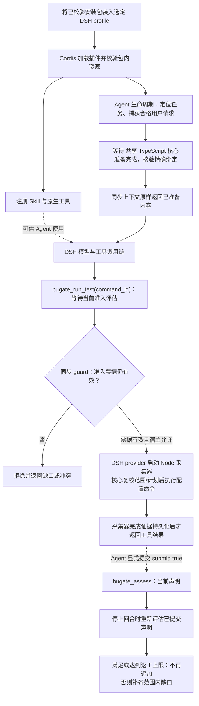
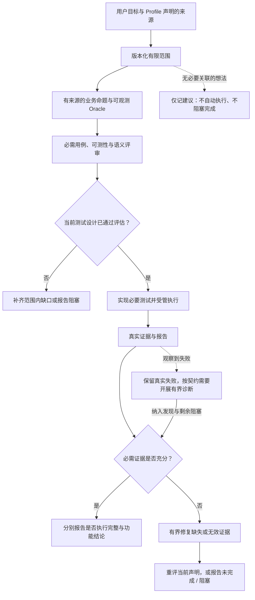

# BUGate v2

[English](README.md) | 简体中文

BUGate 定义有限验收任务的质量要求，并评估已记录的事实能否支持验收声明。它将用户目标、业务要求、可观测 Oracle、必需用例与真实执行证据关联起来，让 Agent 能够说明：**本轮覆盖了什么、实际发生了什么、可以得出什么结论。**

**DeepSeek Harness（DSH）是唯一产品宿主。** 本 TypeScript 分支提供宿主无关的 TypeScript 核心、版本化协议和统一 Node CLI；原生 DSH 插件消费这些评估结果，约束受治理执行和完成声明。DSH 负责 Agent loop、工具、调度、会话生命周期和有界返工。

**实施状态：** 2026-10-30 请求已授权 `2.2.0-dev.1` TypeScript 核心/工具链与官方 DSH Agent Team 互审，当前实施及验证进行中。精确安装包通过 runtime 和独立安装验收后才切换；历史 Python 发布保持不变。详见 [TypeScript/Cordis 计划](docs/plans/TYPESCRIPT_CORDIS.zh-CN.md)。

**开发分支（2026-10-30）：** Python 改进版与全面 TypeScript 版在独立分支/worktree 开发。首轮实战优先使用通过自身 runtime 与安装验收的 Python 改进版；TS 独立继续，不自动替换实战安装。详见[分支边界与 Python 实战计划](docs/plans/PYTHON_FIELD_TRIAL.zh-CN.md)。本 checkout 的实现与安装说明描述 TS 路线，不代表 Python 改进版已交付或实战已完成。

## 围绕用户目标确定验收范围

默认形成约定目标的最小充分证据闭环：广度有界，深度充分。例如，目标包含业务状态落盘时，仅有接口返回成功并不足以证明它。用户目标或已采纳要求包含权限、边界、失败或多条流程时，这些行为就是必需范围。通用风险矩阵不会自动为每个任务增加这些类别。

- **Profile** 声明业务证据来源，并固定任务的需求/风险覆盖分母。
- **ScopeRequest** 记录真实用户选择；**ScopeContract** 通过版本和摘要绑定有限目标、对象/环境、流程及必要分支、Oracle、场景必要性、排除项、辅助活动边界和完成条件。用户选择不能替代业务证据。
- 现有的**用例 inventory** 是可执行计划。必需用例关联当前范围、要求、Oracle 和预期证据。有来源的语义评审负责判断必要性，字段齐全本身不能证明这一点。
- **Suggestion** 保存范围外想法，不包含可执行计划，不进入必需覆盖或完成阻塞。读取资料、准备数据、检查证据、清理，以及关联当前失败的有界诊断，保持为辅助活动。

需要扩大测试时，明确提出新增目标或必需行为。在已锁定的 Profile 覆盖分母内，用户授权的分支/Oracle 变更产生新范围版本；改变分母则需要新 Profile 版本和新任务。既有事实与失败保留，旧评估不能授权变化后的输入。本版本在范围变化后保守地要求重新执行，尚不选择性复用旧证据。

参阅[范围行为与示例](docs/ACCEPTANCE_SCOPE.zh-CN.md)，包括明确的权限要求、验收失败和不阻塞完成的建议。这些例子不构成所有 SUT 的默认测试矩阵。

## 区分证据与结论

Oracle 描述证明某项要求所需的可观测业务结果。结构校验、语义评审与真实执行是独立评估维度。模型自报通过、内容哈希和命令成功都不能替代该业务结果。

| 实际观察 | 可支持的结论 |
|---|---|
| 必需执行和证据齐备，Oracle 成立 | 验收执行完成；所覆盖要求已验证。 |
| 必需执行和证据齐备，真实 Oracle 失败 | 验收执行完成；功能验收失败，保留失败。 |
| 缺少必需执行或证据，存在跳过或未观察 | 执行/证据闭环未完成，尚未建立验证结论。 |
| 仍有范围外建议 | 范围内结论不变；建议单独列出。 |

`execution_complete` 与 `requirement_verified` 分别评估。验证一个指定要求，不会将其他必需工作标记为完成。报告分别说明实际覆盖、功能结果、执行阻塞和建议，并声明：**“本结论仅覆盖本次约定范围。”**

## 架构与权威边界

### 插件如何在 DSH 中生效

安装到 DSH 实际启动的 profile，使用目标 Profile 初始化任务；发现多个任务时通过 `taskPath` 明确选择。安装和 doctor 证明配置/完整性，实际 Agent 会话才能证明 runtime hydration。没有绑定任务时不会激活此路径，插件也不自动初始化任务。下图描述默认的 `mode: managed`；`advisory` 省略受管写入准入，但评估语义及 `bugate_run_test` 内部范围检查仍然生效。



Skill 在插件加载时注册，不是每次准备后重新生成，也不假设模型每轮主动调用 Skill。可等待的生命周期刷新提供 `PreparedProtocolContext`；同步 context/guard 只消费已完成状态。模型准入检查会拒绝因竞争而失效的上下文。恢复会话和子 Agent 各自准备绑定，不继承父 Agent 的局部 guard。

受管测试/活动只接收宿主配置的 `command_id`，不接受模型任意 argv。核心再次检查范围/计划适用性，保留真实输出后才返回。已知受管写入工具有准入控制；对于已绑定任务，managed 准入直接拒绝原生 `bash` 调用，不推断其业务含义，执行应使用配置的命令。其他工具仍由宿主策略管理。filesystem/subprocess provider 决定 execution world，opaque target 不是本地路径。

自动完成检查在 `bugate_assess` 使用 `submit: true` 后生效。未提交时不启动此完成返工路径，DSH 仍可正常停止。停止回合时插件重新评估已提交声明；补证受次数/时间限制，遇到重复缺口或取消也停止。回合停止不代表评估通过。BUGate 提供 findings 和引导，调度与 Agent loop 仍由 DSH 负责。

### 如何支持测试开发

Agent 仍负责理解需求和编写测试；BUGate 将范围、设计前提和结论所需证据明确化：



读取需求、准备数据、检查证据和清理仍可作为合法辅助工作开展；业务证据未齐不会阻塞全部此类操作。诊断命令必须关联当前失败，并有剩余约定预算；达到边界后保留发现或阻塞。补证和诊断都不允许缩减目标、降低断言或追加无关测试来把真实失败改成全绿。

| 环节 | BUGate 增加的机制 | 边界 |
|---|---|---|
| 范围 | 可追溯目标、必要分支和独立建议通道。 | 不自动生成完整风险矩阵或扩大 Profile 分母。 |
| 设计 | 来源/Oracle/用例关联，受管实现前评估当前设计。 | 结构有效和评审意见不证明业务事实正确。 |
| 执行 | 当前绑定、受管采集与证据持久化屏障。 | 约束已声明工具/provider，不是通用 shell 或操作系统沙箱。 |
| 结论 | 执行完整性、功能结果、阻塞和建议分别表达。 | 真实失败保持失败，缺少观察不能转为已验证。 |

这些是已实现机制，不是已实证的模型效率或缺陷发现率提升。细节见[执行流程](docs/qa-methodology/SOP.zh-CN.md)、[配置与边界](adapters/deepseek-harness/plugin/README.zh-CN.md)、[原生生命周期代码](adapters/deepseek-harness/plugin/src/index.ts)和[执行采集器](packages/core/src/evidence.ts)。

### 规则与实现的位置

| 位置 | 职责 |
|---|---|
| [`protocol/v2/`](protocol/v2/) | 唯一机器规范：Schema、MethodSpec、质量规则和 reason codes。 |
| [`packages/core/`](packages/core/) | 宿主无关的校验、快照、证据与声明评估，以及统一 JSON CLI。 |
| [`adapters/deepseek-harness/`](adapters/deepseek-harness/) | 原生工具、执行准入、上下文/生命周期接入和真实 DSH 验收。 |
| [`views/skills/bugate/`](views/skills/bugate/) | 精简入口投影；构建时附加规范 MethodSpec 资源并封存摘要。 |
| [`packaging/`](packaging/) | 明确的资源清单、有限 Node 安装包和有所有权边界的安装生命周期。 |
| [`docs/qa-methodology/`](docs/qa-methodology/) | 解释协议及其使用流程。 |

## 安装并开始任务

使用同一次已验证构建的 `2.2.0-dev.1` Node 安装包、独立安装器及校验和。本次实现不是新公开 release。通过[安装 Prompt](INSTALL_DSH_PROMPT.zh-CN.md)或[安装恢复指南](docs/DEEPSEEK_HARNESS.zh-CN.md)，明确选择外部项目、DSH profile 和 home。运行时不依赖源码 checkout 或 Python。DSH/官方 Team 为 `0.2.2-alpha.2`、Cordis 为 `4.0.6-alpha.1`、Node 为 `24.9.0+`；宿主依赖可能需 registry。只报告实测平台，不推导 Windows 支持。

安装后，依据 [Profile Schema](protocol/v2/schemas/profile.schema.json)编写有来源的 Profile，再初始化任务：

```sh
BUGATE=/absolute/path/dsh-home/profiles/PROFILE/node_modules/.bin/bugate
"$BUGATE" init --project /absolute/path/test-repo --task TASK-1 \
  --sut-profile /absolute/path/profile.json --json
"$BUGATE" protocol prepare \
  --task /absolute/path/test-repo/test-task/TASK-1 --json
```

在 DSH 集成中选择该任务，并说明有限的验收目标。DSH 捕获符合来源条件的用户请求；Agent 通过原生工具记录范围和有来源的设计，执行配置的测试，再评估对应声明。[执行流程](docs/qa-methodology/SOP.zh-CN.md)和 [DSH 使用指南](docs/DEEPSEEK_HARNESS.zh-CN.md)说明范围登记、任务选择、命令配置、查看、变更和恢复。

CLI 输出单个版本化 `CommandResult` JSON。调用完成仍可能报告缺口或测试失败，须查看命令结果和声明 verdict。本次是破坏性 v2 预发布；旧任务格式和已退役宿主集成没有自动转换或回退运行时。

## 开发与验证

先阅读 [AGENTS](AGENTS.zh-CN.md)、[METHOD](docs/qa-methodology/METHOD.zh-CN.md)、[SOP](docs/qa-methodology/SOP.zh-CN.md)和[协议指南](docs/qa-methodology/BUGATE_2_0_PROTOCOL_GUIDE.zh-CN.md)。[CONTRIBUTING](CONTRIBUTING.zh-CN.md)提供本地设置、核心回归、适配器构建、安装包边界及真实 runtime 命令。仓库测试使用临时通用 fixture；真实 SUT 源码、环境、秘密和任务证据放在外部测试工作区。

[范围治理交付记录](docs/reports/scope-convergence/DELIVERY.zh-CN.md)将实施阶段的正式要求关联到所记录快照的实际核心、DSH 和安装证据。发布打包的资源字节可能不同；[发布说明](docs/releases/DSH_2_1_0_DEV_1.zh-CN.md)标识精确发布产物及其验证，不继承旧包的通过结论。

runtime 验证使用确定性模型 fixture 驱动真实 DSH 与官方 Team 成员/工具；最终已安装包验证须关联精确产物摘要，并由操作系统禁止读取源码及执行 Python。**未运行 live-model 验证。** 这些观察不能证明模型质量或效率提升。本地证据哈希也无法对抗拥有同一文件系统控制权的行为者。

| 后续阅读 | 用途 |
|---|---|
| [能力说明](CAPABILITIES.zh-CN.md) | 支持行为和产品边界。 |
| [范围指南](docs/ACCEPTANCE_SCOPE.zh-CN.md) | 最小充分证据、范围变更和结果示例。 |
| [DSH 指南](docs/DEEPSEEK_HARNESS.zh-CN.md) | 安装、工具、执行配置和恢复。 |
| [协议](protocol/v2/README.zh-CN.md) | 规范实体和机器契约。 |
| [架构决策](docs/reports/scope-convergence/ARCHITECTURE.zh-CN.md) | 范围设计与工程取舍。 |
| [验收矩阵](docs/reports/scope-convergence/ACCEPTANCE_MATRIX.zh-CN.md) | 需求来源、Oracle 和已运行证据。 |

[MIT 许可](LICENSE)。

## 官方 Agent Team 交叉互审

必要视角由有效 Profile 和采纳要求决定，没有固定角色数或全员两两互审矩阵。Team 的名册、live Agent/session、fresh/fork 上下文、工具调用及最终结果提供可观察来源；模型填写的名称或“已独立评审”不构成证明。输出与 HostObservation 持久化后，还须成功的 HostSettlement 才可评估。工件、范围、计划或输入快照变化会使旧评审失效。

原始意见、反证、限制、交叉讨论和异议处置保留关联。消息接受与 Team task complete 均不等于评审通过；一致 pass 不替代 Oracle。fork 不是盲审，执行分离不保证认知独立，writeScopes 不提供工作树隔离。同权限文件系统篡改不在本地宿主观察保证范围。
