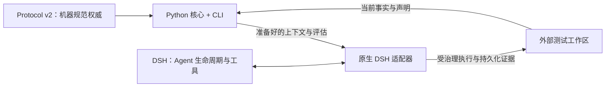

# BUGate v2

[English](README.md) | 简体中文

BUGate 定义有限验收任务的质量要求，并评估已记录的事实能否支持验收声明。它将用户目标、业务要求、可观测 Oracle、必需用例与真实执行证据关联起来，让 Agent 能够说明：**本轮覆盖了什么、实际发生了什么、可以得出什么结论。**

**DeepSeek Harness（DSH）是唯一产品宿主。** BUGate 提供宿主无关的 Python 核心、版本化协议和统一 CLI；原生 DSH 插件消费这些评估结果，约束受治理执行和完成声明。DSH 负责 Agent loop、工具、调度、会话生命周期和有界返工。

## 围绕用户目标确定验收范围

默认形成约定目标的最小充分证据闭环：广度有界，深度充分。例如，目标包含业务状态落盘时，仅有接口返回成功并不足以证明它。用户目标或已采纳要求包含权限、边界、失败或多条流程时，这些行为就是必需范围。通用风险矩阵不会自动为每个任务增加这些类别。

- **Profile** 声明业务证据来源，并固定任务的需求/风险覆盖分母。
- **ScopeRequest** 记录真实用户选择；**ScopeContract** 通过版本和摘要绑定有限目标、对象/环境、流程及必要分支、Oracle、场景必要性、排除项、辅助活动边界和完成条件。用户选择不能替代业务证据。
- 现有的**用例 inventory** 是可执行计划。必需用例关联当前范围、要求、Oracle 和预期证据。有来源的语义评审负责判断必要性，字段齐全本身不能证明这一点。
- **Suggestion** 保存范围外想法，不包含可执行计划，不进入必需覆盖或完成阻塞。读取资料、准备数据、检查证据、清理，以及关联当前失败的有界诊断，保持为辅助活动。

需要扩大测试时，明确提出新增目标或必需行为。在已锁定的 Profile 覆盖分母内，用户授权的分支/Oracle 变更产生新范围版本；改变分母则需要新 Profile 版本和新任务。既有事实与失败保留，旧评估不能授权变化后的输入。本版本在范围变化后保守地要求重新执行，尚不选择性复用旧证据。

参阅[范围行为与示例](docs/ACCEPTANCE_SCOPE.zh-CN.md)，包括明确的权限要求、验收失败和不阻塞完成的建议。这些例子不构成所有 SUT 的默认测试矩阵。

## 区分证据与结论

Oracle 描述证明某项要求所需的可观测业务结果。结构校验、语义评审与真实执行是独立评估维度。模型自报通过、内容哈希和命令成功都不能替代该业务结果。

| 实际观察 | 可支持的结论 |
|---|---|
| 必需执行和证据齐备，Oracle 成立 | 验收执行完成；所覆盖要求已验证。 |
| 必需执行和证据齐备，真实 Oracle 失败 | 验收执行完成；功能验收失败，保留失败。 |
| 缺少必需执行或证据，存在跳过或未观察 | 执行/证据闭环未完成，尚未建立验证结论。 |
| 仍有范围外建议 | 范围内结论不变；建议单独列出。 |

`execution_complete` 与 `requirement_verified` 分别评估。验证一个指定要求，不会将其他必需工作标记为完成。报告分别说明实际覆盖、功能结果、执行阻塞和建议，并声明：**“本结论仅覆盖本次约定范围。”**

## 架构与权威边界



| 位置 | 职责 |
|---|---|
| [`protocol/v2/`](protocol/v2/) | 唯一机器规范：Schema、MethodSpec、质量规则和 reason codes。 |
| [`src/bugate/`](src/bugate/) | 宿主无关的校验、快照、证据与声明评估，以及统一 JSON CLI。 |
| [`adapters/deepseek-harness/`](adapters/deepseek-harness/) | 原生工具、执行准入、上下文/生命周期接入和真实 DSH 验收。 |
| [`views/skills/bugate/`](views/skills/bugate/) | 精简入口投影；构建时附加规范 MethodSpec 资源并封存摘要。 |
| [`packaging/`](packaging/) | 明确的资源清单、独立 wheel/原生安装包和有所有权边界的安装生命周期。 |
| [`docs/qa-methodology/`](docs/qa-methodology/) | 解释协议及其使用流程。 |

`PreparedProtocolContext` 携带当前精确绑定及可操作缺口。恢复的会话、子 Agent 和独立 preset 各自准备绑定。适配器在 DSH 支持的异步接缝等待准备和证据持久化完成，同步 context/guard 回调只消费已完成状态。执行使用配置的 filesystem/subprocess provider，以及已声明的用例/活动标识。约束覆盖可观察的受治理操作，不从任意 shell 文本推断全部业务含义，也不越过宿主权限。

## 安装并开始任务

安装入口固定到
[`dsh-v2.1.0-dev.1`](https://github.com/ZhangLiangchen/BUGate/releases/tag/dsh-v2.1.0-dev.1)：Python `bugate-core 2.1.0a1`、原生包 `2.1.0-dev.1`，以及精确绑定的 Protocol `2.1.0-dev.1`。使用[一键安装 Prompt](INSTALL_DSH_PROMPT.zh-CN.md)或[安装恢复指南](docs/DEEPSEEK_HARNESS.zh-CN.md)。bundle、安装器和校验和必须来自同一次构建；明确选择外部测试项目、DSH profile 和 bootstrap 环境。运行时安装不需要 BUGate 源码 checkout。

适配器面向 DSH `0.2.2-alpha.2` 和 Node `24.9.0+`。Python 核心要求 `3.11+`；随包依赖 wheel 必须匹配 `python/inventory.json` 记录的 Python/平台 ABI。[发布说明](docs/releases/DSH_2_1_0_DEV_1.zh-CN.md)列出打包平台和验证结果。不支持 Windows。Python 依赖离线安装，DSH peer dependencies 的解析可能需要访问 registry。

安装后，依据 [Profile Schema](protocol/v2/schemas/profile.schema.json)编写有来源的 Profile，再初始化任务：

```sh
BUGATE=/absolute/path/bugate-bootstrap/bin/bugate
"$BUGATE" init --project /absolute/path/test-repo --task TASK-1 \
  --sut-profile /absolute/path/profile.json --json
"$BUGATE" protocol prepare \
  --task /absolute/path/test-repo/test-task/TASK-1 --json
```

在 DSH 集成中选择该任务，并说明有限的验收目标。DSH 捕获符合来源条件的用户请求；Agent 通过原生工具记录范围和有来源的设计，执行配置的测试，再评估对应声明。[执行流程](docs/qa-methodology/SOP.zh-CN.md)和 [DSH 使用指南](docs/DEEPSEEK_HARNESS.zh-CN.md)说明范围登记、任务选择、命令配置、查看、变更和恢复。

CLI 输出单个版本化 `CommandResult` JSON。调用完成仍可能报告缺口或测试失败，须查看命令结果和声明 verdict。本次是破坏性 v2 预发布；旧任务格式和已退役宿主集成没有自动转换或回退运行时。

## 开发与验证

先阅读 [AGENTS](AGENTS.zh-CN.md)、[METHOD](docs/qa-methodology/METHOD.zh-CN.md)、[SOP](docs/qa-methodology/SOP.zh-CN.md)和[协议指南](docs/qa-methodology/BUGATE_2_0_PROTOCOL_GUIDE.zh-CN.md)。[CONTRIBUTING](CONTRIBUTING.zh-CN.md)提供本地设置、核心回归、适配器构建、安装包边界及真实 runtime 命令。仓库测试使用临时通用 fixture；真实 SUT 源码、环境、秘密和任务证据放在外部测试工作区。

[范围治理交付记录](docs/reports/scope-convergence/DELIVERY.zh-CN.md)将实施阶段的正式要求关联到所记录快照的实际核心、DSH 和安装证据。发布打包的资源字节可能不同；[发布说明](docs/releases/DSH_2_1_0_DEV_1.zh-CN.md)标识精确发布产物及其验证，不继承旧包的通过结论。

已记录的集成验证使用确定性模型 fixture 驱动真实 DSH runtime，包括禁止读取源码 checkout 的已安装包流程。**未运行 live-model 验证。** 这些观察不能证明模型质量或效率提升。本地证据哈希也无法对抗拥有同一文件系统控制权的行为者。

| 后续阅读 | 用途 |
|---|---|
| [能力说明](CAPABILITIES.zh-CN.md) | 支持行为和产品边界。 |
| [范围指南](docs/ACCEPTANCE_SCOPE.zh-CN.md) | 最小充分证据、范围变更和结果示例。 |
| [DSH 指南](docs/DEEPSEEK_HARNESS.zh-CN.md) | 安装、工具、执行配置和恢复。 |
| [协议](protocol/v2/README.zh-CN.md) | 规范实体和机器契约。 |
| [架构决策](docs/reports/scope-convergence/ARCHITECTURE.zh-CN.md) | 范围设计与工程取舍。 |
| [验收矩阵](docs/reports/scope-convergence/ACCEPTANCE_MATRIX.zh-CN.md) | 需求来源、Oracle 和已运行证据。 |

[MIT 许可](LICENSE)。
